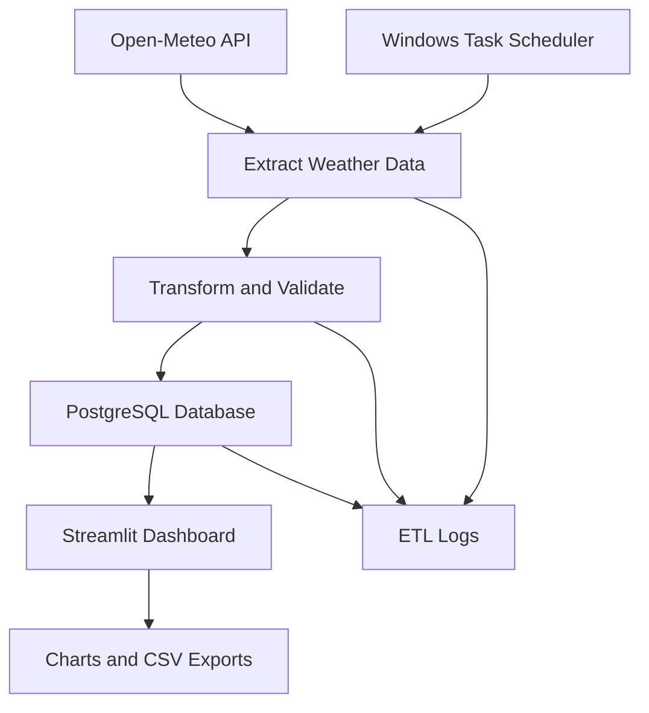
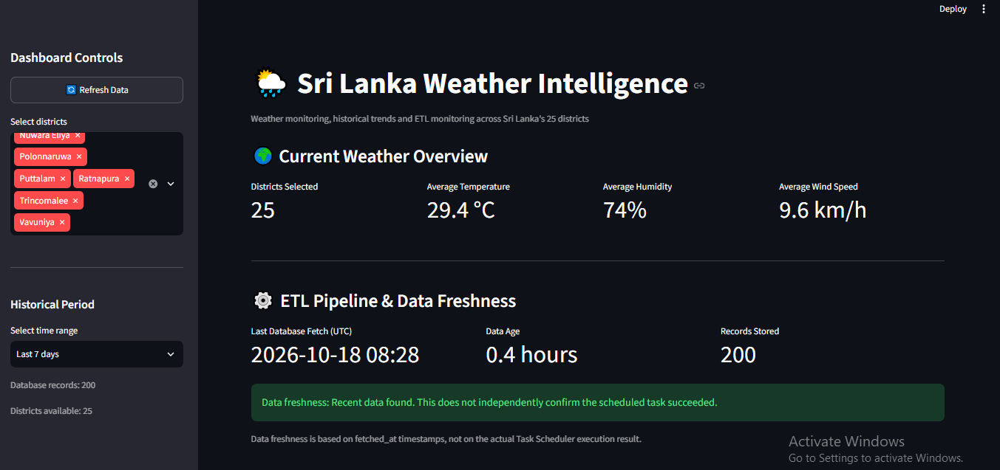
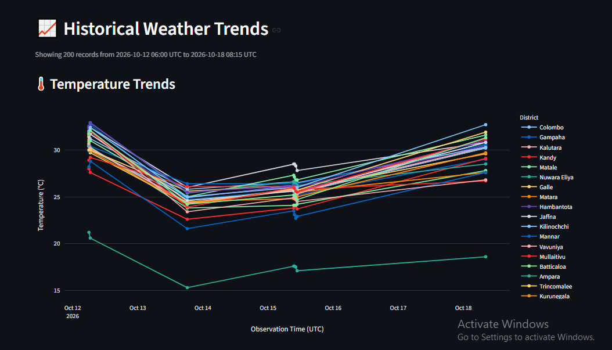
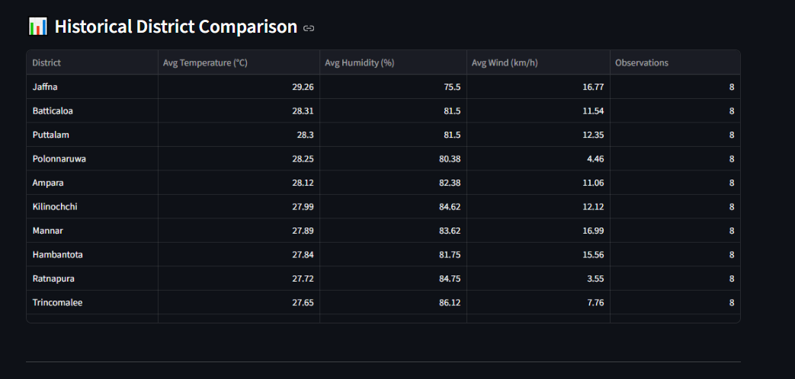
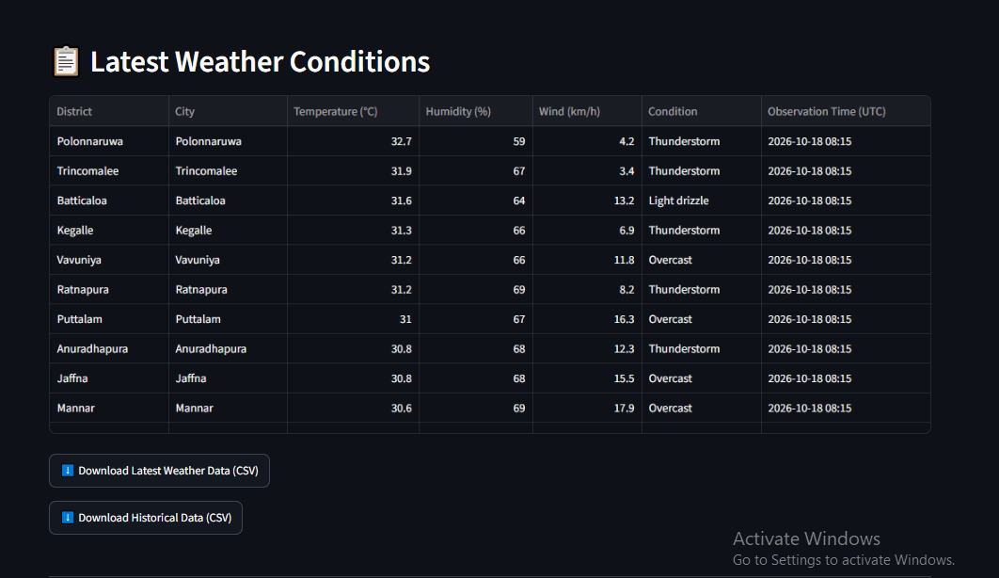

# Sri Lanka Weather ETL Pipeline

A Python-based ETL pipeline that collects weather data for Sri Lanka's 25 districts, stores observations in PostgreSQL, and presents weather insights through a Streamlit dashboard.


## Features

- Weather data collection using the Open-Meteo API
- Data processing and transformation with Python and Pandas
- PostgreSQL storage using SQLAlchemy
- Duplicate handling through database upserts
- Interactive Streamlit dashboard
- District-level temperature and humidity comparisons
- Historical weather trend visualizations
- CSV downloads for latest and historical data
- Logging for ETL execution and district-level failures
- Hourly execution configured through Windows Task Scheduler

## Architecture





## Technology Stack

- Python
- Pandas
- Requests
- SQLAlchemy
- PostgreSQL
- Psycopg
- Streamlit
- Plotly
- Prefect
- Windows Task Scheduler

## Project Structure

```text
weather-etl-pipeline/
├── app.py
├── config.py
├── database.py
├── pipeline.py
├── run_once.py
├── requirements.txt
├── .gitignore
├── .env.example
└── logs/
```

The `logs/` directory is generated locally when the ETL runner executes. Local environment files, virtual environments and log files should not be committed.

## Prerequisites

- Python 3.11 or later
- PostgreSQL
- Git
- An internet connection

## Installation

Clone the repository:

```bash
git clone https://github.com/Avindu-kanishka/weather-etl-pipeline.git
cd weather-etl-pipeline
```

Create and activate a virtual environment on Windows:

```powershell
python -m venv .venv
.\.venv\Scripts\Activate.ps1
```

Install dependencies:

```powershell
python -m pip install -r requirements.txt
```

## Database Configuration

Create a PostgreSQL database and a database user with permission to create and write to the required tables.

Create a `.env` file in the project root:

```dotenv
DB_HOST=127.0.0.1
DB_PORT=5432
DB_NAME=weather_db
DB_USER=weather_app
DB_PASSWORD=replace_with_your_local_password
```

Replace the password placeholder with your local PostgreSQL password.

Never commit `.env` or real credentials to GitHub.

Ensure that `database.py` uses the environment variable names shown above.

## Run the ETL Pipeline

Activate the virtual environment, then run:

```powershell
python run_once.py
```

The runner fetches weather observations for the configured Sri Lankan districts, processes the responses and loads the records into PostgreSQL.

Execution details are written to `logs/weather_etl.log`.

## Launch the Dashboard

Run:

```powershell
python -m streamlit run app.py
```

Open the local dashboard:

http://localhost:8501

The dashboard provides weather summaries, district comparisons, historical trends and CSV exports.

## Scheduled Execution

Hourly execution can be configured locally through Windows Task Scheduler.

Use the virtual environment's Python executable:

```text
<project-folder>\.venv\Scripts\python.exe
```

Program arguments:

```text
run_once.py
```

Set the task's working directory to the project root. Verify scheduled runs using Task Scheduler history and the ETL log.

## Data Source

Weather data is retrieved from the Open-Meteo API.

https://open-meteo.com/

## Security Notes

- Keep `.env` out of version control.
- Never commit passwords, API keys or private credentials.
- Keep virtual environments and generated logs out of the repository.
- Use a database account with only the permissions required by the application.

## Current Scope and Limitations

- The application is configured for Sri Lankan districts.
- Historical charts depend on observations accumulated in the local PostgreSQL database.
- The dashboard is intended for local execution.
- Scheduled execution depends on the computer being available and the PostgreSQL service running.

## License

No license has been specified yet.


## Dashboard Screenshots

### Main Dashboard


### Historical Weather Trends


### Historical District Comparison


### Latest Weather and CSV Export
